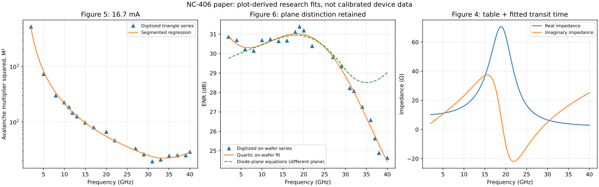

<!-- Modified: 2026-11-22 -->
# Avalanche noise diode and plot fits

`NoiseDiode()` is a floating two-port: **1 anode, 2 cathode**. It implements
the avalanche/drift equivalent circuit from [Maya, Lázaro and Pradell (2003)][paper].
It is separate from `D()` and its classical Zener noise. The built-in
`NC406_REFERENCE` is a **plot-derived research reference**, not a calibrated
Noisecom model or an assembled noise-source calibration.

## Use and limits

```js
nP.global.fList = [2e9, 10e9, 20e9, 40e9];
var nd1 = nP.NoiseDiode({model: 'NC406_REFERENCE'});
var table = nd1.noiseTable();
nP.lineTable({inputTable: table});
```

The reference is fixed at reverse-current magnitude **16.7 mA**, physical
temperature **300 K**, and **2–40 GHz**. Every analysis frequency must lie
inside the fit interval. `temperature` may only equal the record's
`referenceTemperature`; changing temperature or bias requires another complete
record. There is no bias interpolation, temperature scaling or extrapolation.

`qPoint` reports `{id: -0.0167, vd: null, temperature: 300}`. No DC voltage is
invented: Table 1 and Figure 4 give conflicting voltages. The immutable DC
descriptor is `requiresModel`; `solveDC()` rejects absent DC conduction data.
This device cannot participate in external-bias handoff. An RF-only composition
does not establish a valid DC bias. Deterministic IM requests reject the absent
nonlinear current/charge fit, including through composed networks.

`noiseTable({coldTemperature: 290, referenceTemperature: 290})` returns:

| Column | Meaning |
| --- | --- |
| Freq | Hz |
| enr (dB) | `10 log10((Thot-Tcold)/Treference)`; requires positive excess |
| noiseTemperature (K) | Available hot noise temperature at diode terminals |
| availableNoise (dBm/Hz) | `k Thot`, available under conjugate matching |
| deliveredNoise (dBm/Hz) | Noise delivered into the selected real `global.Ro` |
| sourceReflectionMag | One-port `abs((Z-Ro)/(Z+Ro))` with opposite terminal grounded |

The assumed cold reference is **not an off-state diode model**. The table's
source reflection is not the bare floating two-port's S11. `noiseFloor` and NF
are not standalone-source ENR. To connect this source, ground one terminal
with `Short()` and use the other through `nodal()`; its full covariance carries
noise and mismatch through subsequent components. The [browser harness](../../dev/noiseDiode.html)
compares the source with a 10 dB pad. Its own `noise-diode.svg` symbol uses conventional avalanche/Zener geometry,
with an independent symbol identity and unchanged 20-unit pins. It does not
share `D()` equations.

## Digitization and regression



The [pixel samples](../../test/fixtures/noise-diode-plot-data.json) retain axis
calibrations, source checksum and estimated reading bounds. Samples follow
16.7 mA triangle markers and their intervening trace; some overlap other
series. Bounds are digitization assumptions, **not measurement uncertainty**.
The 8.4/24.4 mA curves have not been fitted. Least squares is unweighted.

For `f` in Hz, define `u = ln(f/1e10)` and `h = max(ln(f/3e10),0)`:

```text
10 log10(M²) = 23.2550824333 - 8.4790215869 u + 36.1471060961 h²
```

The multiplier fit is continuous with continuous first slope. A global power
law misses the upturn; higher global polynomials extrapolate poorly between
samples. The selected segmented fit has RMS **0.371 dB**, maximum **0.863 dB**,
and leave-one-out RMS **0.440 dB**, measured in `10 log10(M²)`.

Separately, with `t = (f/1e9 - 21)/19`, the on-wafer ENR fit is:

```text
ENR_dB = 30.9214466568 - 1.5056547323 t - 5.9092201931 t²
         - 1.7340909754 t³ + 2.6746033838 t⁴
```

RMS is **0.227 dB**, maximum **0.435 dB**, leave-one-out RMS **0.308 dB**.
These residuals describe our reading of the plot, not absolute source accuracy.
Candidate selection uses leave-one-out scores on the same data; this is a
model-selection diagnostic, not independent or nested validation. The full
[report](noiseDiodeFit.json) preserves alternatives and numeric samples.

Figure 5 describes intrinsic avalanche multiplication. Figure 6 includes the
JMICRO transition. Its quartic is diagnostic only and is **not** used as the
intrinsic runtime noise law. At 40 GHz the diode equations predict about
29.0 dB ENR, versus about 24.4 dB from the on-wafer fit. The transition model
is unavailable; this reference-plane difference does not prove the entire
discrepancy is explained. Low-frequency disagreement and source ambiguities
also remain. No frequency-dependent correction has been inserted to hide them.

Only omitted transit time was fitted against Figure 4, holding published
Table 1 values fixed: **10.898 ps**. The nearest-ink distance is **0.988 pixel
RMS**, not an impedance error. Measured/initial/optimized traces overlap, so
this does not uniquely fit the measured trace. It is not an independently
verified transit-time extraction using the paper's low-frequency estimate.

Reproduce with Python 3, numpy, scipy, matplotlib, Pillow and `pdftocairo`:

```sh
python3 scripts/fit-noise-diode.py --pdf /path/to/paper.pdf
```

The script verifies the PDF checksum and generates the report, standalone SVG
and runtime fit constants. Scientific Python is optional development tooling;
it is not an nP runtime or npm dependency.

## Custom records, parameters and defaults

Named and supplied records use exactly the same validation and construction:

```js
var myModel = {
    name: 'My avalanche fit',
    referenceTemperature: 300,
    parameters: {
        leadInductance: 165.5e-12, packageCapacitance: 160e-15,
        seriesResistance: 5.43, depletionResistance: 102.58,
        driftCapacitance: 169.44e-15, driftResistance: 4.85,
        avalancheFrequency: 26.59e9, transitTime: 1.0898084644200209e-11,
        avalancheLengthRatio: .5, biasCurrent: .0167
    },
    noiseFit: {
        referenceFrequency: 1e10, kneeFrequency: 3e10,
        coefficientsDb: [23.25508243327507, -8.479021586882642, 36.14710609607268],
        minFrequency: 2e9, maxFrequency: 40e9
    }
};
var nd1 = nP.NoiseDiode({model: myModel});
```

| Parameter | Unit / requirement | Generic default |
| --- | --- | --- |
| depletionResistance, driftResistance | Ω, positive | Required |
| driftCapacitance | F, positive | Required |
| avalancheFrequency | Hz, positive | Required |
| transitTime | s, positive | Required |
| biasCurrent | A, positive reverse-current magnitude | Required |
| leadInductance | H, nonnegative | 0 |
| packageCapacitance | F, nonnegative | 0 |
| seriesResistance | Ω, nonnegative physical contact resistance | 0 |
| avalancheLengthRatio | Dimensionless, nonnegative | 0.5 |

All five `noiseFit` fields are required; frequencies are positive Hz, bounds
increase, knee lies within bounds, and coefficients are three finite dB values
for the exact law above. `referenceTemperature` defaults to 300.15 K for a
custom record. It and all parameter values must be finite. Unknown keys and
nonempty package L/C arrays are rejected; this circuit has one fixed package
topology. Optional provenance is preserved, never fetched. No custom record
borrows NC406 fit data. Supplying a new current without its corresponding RF
and noise fit does not establish physical bias dependence.

## Equations and numerical verification

The RF circuit uses Eq. 4's `Zd=Rd+Za`, `Zi=Rj || Zd`,
`Zs=Rs+Zi`, `Zp=Zs/(1+jωCpZs)` and `Z=jωLp+Zp`.
Set `r=f/fa`, `e=1-r²`, `θ=ωτ`, and `sinc(x)=sin(x)/x`:

```text
a = Ra sinc(θ/2)²
b = [1-sinc(θ)-r²(1+ρ)]/(ωCd)
N = a-jb
Zi = Rj N/(N+e Rj)
Havalanche = (-j b Rj)/(N+e Rj)
Hpackage = 1+jωCpZs
Si = 2q abs(ID) M²                                  [A²/Hz]
Sv_open = (Si abs(Havalanche)² + 4kT Rs)/abs(Hpackage)² [V²/Hz]
Thot = Sv_open/(4k Re(Z))                            [K]
```

Common poles cancel algebraically before evaluation at `fa`; no arbitrary
frequency shift or clipping is used. Small-angle sinc terms use analytic
series. Only physical contact resistance receives Johnson noise; effective
avalanche/drift resistances are not equilibrium resistors. With reference
resistance `Ro`, the floating two-port's covariance diagonal is
`Ro Sv_open / abs(Z+2Ro)²`, with equal negative off-diagonals.

The [ngspice deck](../../test/fixtures/noise-diode-equivalent.cir) independently
constructs the original frequency-dependent Eq. 4 branches and noise sources
at seven frequencies. [Tests](../../test/noise-diode.test.js) compare all four
S entries and device covariance, check exact-pole continuity, named/custom
equivalence including foreign JS contexts, source loading and attenuation,
and synthetic Y-factor recovery of a known receiver NF. The synthetic cold
state is not a fitted NC406 off state. These are implementation checks, not
measured-device calibration. Algebra and explicit SI dimensions are also
included in the optional equation audit.

[paper]: https://upcommons.upc.edu/server/api/core/bitstreams/01200fd7-3902-48b4-a987-161b9dd9a521/content
