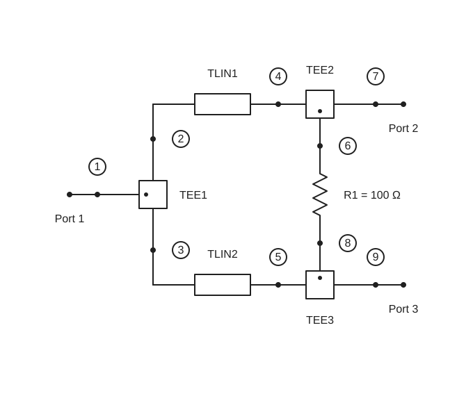
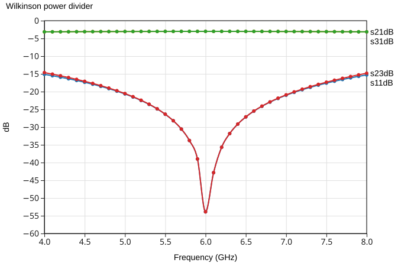
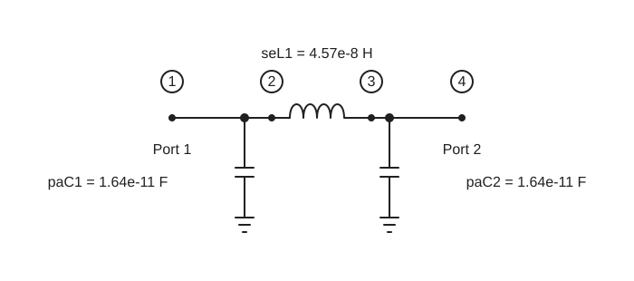
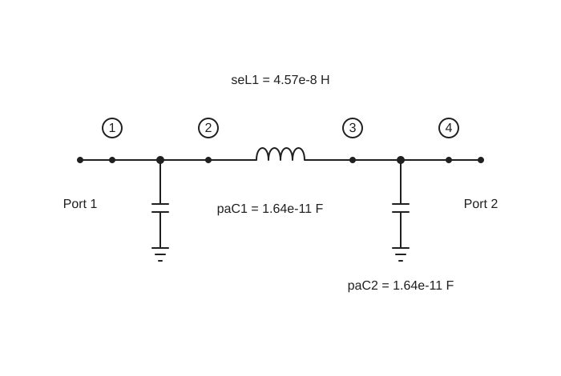
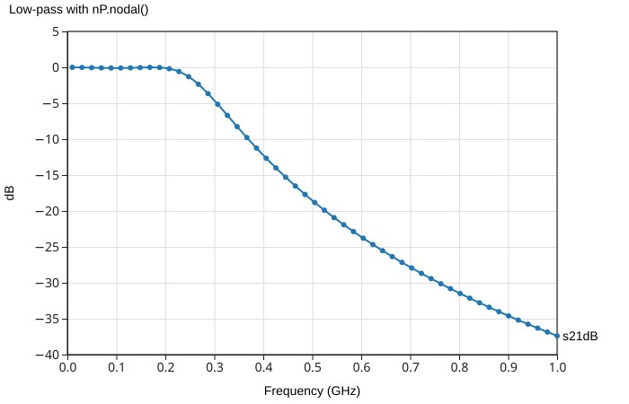
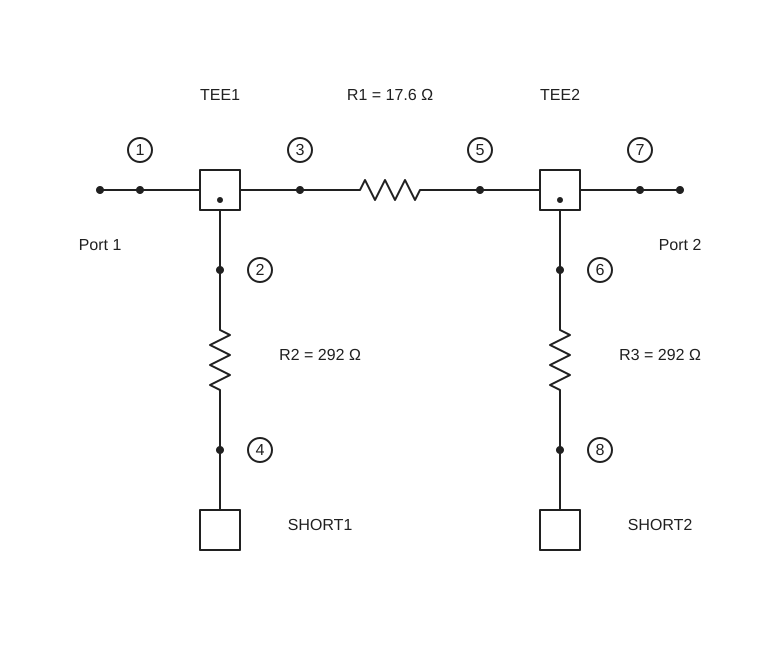
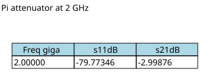
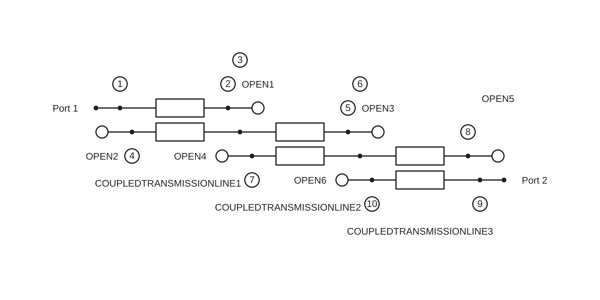
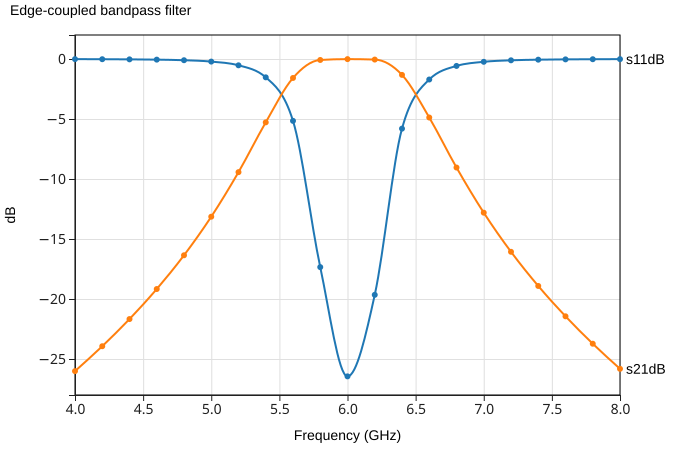

<!-- Modified: 2026-11-08 -->
<!-- Regenerate illustrations: node scripts/generate-circuit-example-images.mjs -->
# Circuit examples

These circuits show how individual n-ports become useful RF networks. Each example sets its frequencies, creates its parts, connects them, then displays selected S-parameters. The code assumes the `nP` browser bundle has been loaded, as in [Hello, nPort!](./hello-nport.md).

The illustrations below are generated by running these code blocks with the current browser bundle. Each example calls [nP.schematic()](./schematics.md) to draw its network; the accompanying chart or table comes from the same calculation.

## Wilkinson power divider

An ideal three-port junction splits the input into two quarter-wave branches. A 100 Ω resistor connects the output arms for isolation. The external port order is input, output 1, output 2.

[Open in REPL](./repl.md#example-wilkinson-power-divider)

```js
// Wilkinson power divider

nP.global.fList = nP.global.fGen(4e9, 8e9, 41);

var inputTee = nP.Tee();
var outputTee1 = nP.Tee();
var outputTee2 = nP.Tee();
var branch1 = nP.Tlin(70.7, 0.49 * 0.0254);
var branch2 = nP.Tlin(70.7, 0.49 * 0.0254);
var isolationR = nP.R(100);

var divider = nP.nodal(
    [inputTee, 1, 2, 3],
    [branch1, 2, 4],
    [branch2, 3, 5],
    [outputTee1, 6, 4, 7],
    [outputTee2, 8, 5, 9],
    [isolationR, 6, 8],
    ['out', 1, 7, 9]
);

var response = divider.out('s11dB', 's21dB', 's31dB', 's23dB');
nP.schematic(divider);
nP.lineChart({
    inputTable: [response],
    title: 'Wilkinson power divider',
    metricPrefix: 'giga',
    xAxisTitle: 'Frequency (GHz)'
});
```

`s21dB` and `s31dB` show the two output paths. `s11dB` shows input match; `s23dB` shows isolation between the outputs. The line length above is close to a quarter wavelength near 6 GHz in the ideal vacuum-speed model.





## Low-pass filter four ways

Here is the same three-element C-L-C filter connected four ways. Each example stands on its own and shows its own schematic and transmission response. The responses are the same.

The `paC()` parts include their shunt capacitors; `seL()` supplies the series inductor. See [Filters](./filters.md) for the Chebyshev helpers and a custom `lpfGen()` input.

### Low-pass with .cas()

[Open in REPL](./repl.md#example-low-pass-cas)

```js
// Low-pass with .cas()

nP.global.fList = nP.global.fGen(10e6, 1e9, 51);

var c1 = nP.paC(16.41818746502858e-12);
var l1 = nP.seL(45.65360855435164e-9);
var c2 = nP.paC(16.41818746502858e-12);

var byMethod = c1.cas(l1).cas(c2);

var response = byMethod.out('s21dB');
nP.schematic(byMethod);
nP.lineChart({
    inputTable: [response],
    title: 'Low-pass with .cas()',
    metricPrefix: 'giga',
    xAxisTitle: 'Frequency (GHz)'
});
```




### Low-pass with nP.cascade()

[Open in REPL](./repl.md#example-low-pass-cascade)

```js
// Low-pass with nP.cascade()

nP.global.fList = nP.global.fGen(10e6, 1e9, 51);

var c1 = nP.paC(16.41818746502858e-12);
var l1 = nP.seL(45.65360855435164e-9);
var c2 = nP.paC(16.41818746502858e-12);

var byCascade = nP.cascade(c1, l1, c2);

var response = byCascade.out('s21dB');
nP.schematic(byCascade);
nP.lineChart({
    inputTable: [response],
    title: 'Low-pass with nP.cascade()',
    metricPrefix: 'giga',
    xAxisTitle: 'Frequency (GHz)'
});
```


### Low-pass with nP.nodal()

[Open in REPL](./repl.md#example-low-pass-nodal)

```js
// Low-pass with nP.nodal()

nP.global.fList = nP.global.fGen(10e6, 1e9, 51);

var c1 = nP.paC(16.41818746502858e-12);
var l1 = nP.seL(45.65360855435164e-9);
var c2 = nP.paC(16.41818746502858e-12);

var byNodes = nP.nodal(
    [c1, 1, 2],
    [l1, 2, 3],
    [c2, 3, 4],
    ['out', 1, 4]
);

var response = byNodes.out('s21dB');
nP.schematic(byNodes);
nP.lineChart({
    inputTable: [response],
    title: 'Low-pass with nP.nodal()',
    metricPrefix: 'giga',
    xAxisTitle: 'Frequency (GHz)'
});
```





### Low-pass with nP.lpfGen()

[Open in REPL](./repl.md#example-low-pass-lpfgen)

```js
// Low-pass with nP.lpfGen()

nP.global.fList = nP.global.fGen(10e6, 1e9, 51);

var byGenerator = nP.lpfGen([
    50,
    16.41818746502858e-12,
    45.65360855435164e-9,
    16.41818746502858e-12,
    50
]);

var response = byGenerator.out('s21dB');
nP.schematic(byGenerator);
nP.lineChart({
    inputTable: [response],
    title: 'Low-pass with nP.lpfGen()',
    metricPrefix: 'giga',
    xAxisTitle: 'Frequency (GHz)'
});
```


## Pi attenuator

Two shunt resistors surround a series resistor. Each shunt path goes from `Tee()` port 1 through a resistor to `Short()`; the series resistor joins the two through paths.

[Open in REPL](./repl.md#example-pi-attenuator)

```js
// Pi attenuator

nP.global.fList = [2e9];

var inputShunt = nP.R(292.4);
var seriesR = nP.R(17.6);
var outputShunt = nP.R(292.4);
var inputTee = nP.Tee();
var outputTee = nP.Tee();
var ground = nP.Short();

var attenuator = nP.nodal(
    [inputTee, 2, 1, 3],
    [inputShunt, 2, 4],
    [ground, 4],
    [seriesR, 3, 5],
    [outputTee, 6, 5, 7],
    [outputShunt, 6, 8],
    [ground, 8],
    ['out', 1, 7]
);

var response = attenuator.out('s11dB', 's21dB');
nP.schematic(attenuator);
nP.lineTable({
    inputTable: [response],
    title: 'Pi attenuator at 2 GHz'
});
```

This illustrates how a circuit of three separate resistors can be measured as a single two-port. The [Connecting nPorts](./connecting-nports.md) page explains the connection labels.





## Edge-coupled bandpass filter

Three ideal coupled-line sections form this filter. `Tclin()` ports are numbered clockwise from the upper left. The unused ends are terminated with `Open()` fixtures.

[Open in REPL](./repl.md#example-edge-coupled-bandpass-filter)

```js
// Edge-coupled bandpass filter

nP.global.fList = nP.global.fGen(4e9, 8e9, 21);

var coupled1 = nP.Tclin(79.667, 37.834, 0.491 * 0.0254);
var coupled2 = nP.Tclin(60.866, 42.505, 0.491 * 0.0254);
var coupled3 = nP.Tclin(79.667, 37.834, 0.491 * 0.0254);
var open = nP.Open();

var filter = nP.nodal(
    [coupled1, 1, 2, 3, 4],
    [coupled2, 3, 5, 6, 7],
    [coupled3, 6, 8, 9, 10],
    [open, 2],
    [open, 4],
    [open, 5],
    [open, 7],
    [open, 8],
    [open, 10],
    ['out', 1, 9]
);

var response = filter.out('s11dB', 's21dB');
nP.schematic(filter);
nP.lineChart({
    inputTable: [response],
    title: 'Edge-coupled bandpass filter',
    metricPrefix: 'giga',
    xAxisTitle: 'Frequency (GHz)'
});
```





For the coupled-line port order and defaults, see [Ideal components](./ideal-components.md#a-lossless-line).
