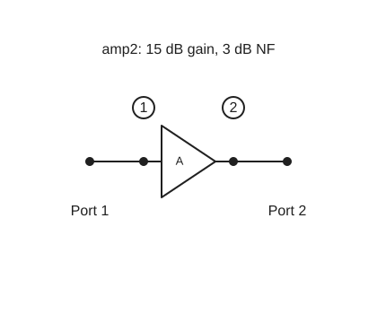

<!-- Modified: 2026-11-19 -->
# Transistors and Diodes

The public active-device constructors are `nP.Amp()`, `nP.D()`, `nP.diode1N4148()`, `nP.NPN()`, `nP.PNP()`, `nP.NJF()`, `nP.PJF()`, `nP.NMOS()` and `nP.PMOS()`. The amplifier is a configurable two-port gain/noise model. Diode and transistor models combine DC I–V curves with RF behavior at a fixed bias.

## NPN transistor

`nP.NPN()` supports **2N3904** (default) and **BFR93A**. It returns a three-port: **1 base, 2 collector, 3 emitter**.

```js
// NPN curve tracer and RF at a selected Q point
var g = nP.global;
g.fList = g.fGen(10e6, 500e6, 51);

var q1 = nP.NPN({
    model: '2N3904',
    configuration: 'commonEmitter',
    bias: {
        ib: {start: 0, stop: 50e-6, points: 6},
        vce: {start: 0, stop: 10, points: 201}
    },
    qPoint: {ib: 20e-6, vce: 5},
    temperature: g.Temp
});
var short = nP.Short();
var amplifier = nP.nodal(
    [q1, 1, 2, 3],
    [short, 3],
    ['out', 1, 2]
);
var curves = q1.ivTable();
var rf = amplifier.out('s11dB', 's21dB');
var stability = amplifier.out('K', 'deltaMag');
var noise = amplifier.out('NF21dB');

nP.lineChart({inputTable: [curves], metricPrefix: 'none',
    title: '2N3904 curve tracer', xAxisTitle: 'VCE (V)', yAxisTitle: 'IC (A)'});
nP.lineChart({inputTable: [rf], metricPrefix: 'mega', title: 'Common-emitter RF'});
```

`bias` defines the curves; `qPoint` fixes the RF operating point. Sweeping does not move it. Construct another NPN with different `qPoint` values to select another point. With no arguments, the constructor uses the defaults above and the current `global.fList`, initially `[2e9]`, just as `R()` does. Partial nested settings keep omitted defaults.

For `commonBase`, use `bias: {ie: {...}, vcb: {...}}` and `qPoint: {ie: 2e-3, vcb: 5}`; its table plots IC versus VCB at stepped outward IE. For `commonCollector`, retain IB and positive VCE; the table reports outward IE. The DC `configuration` does not terminate an RF port: ground emitter, base or collector externally to obtain the corresponding RF configuration. `.bias`, `.qPoint`, `.smallSignal` and `.model` expose the chosen point, linearization and provenance.

Completed two-ports provide `.stability` and `.out('K', 'deltaMag')`. Unconditional small-signal stability requires K > 1 and |Δ| < 1. K comes from the final S-parameters; intermediate K < 1 is allowed. Bare three-port NPNs have no two-port K value.

BFR93A includes its published SOT23 L/C network. The 2N3904 card includes terminal resistances but no explicit package L/C model. Noise uses classical shot/thermal sources, without fitted excess-noise or high-frequency induced-noise behavior. With `global.twoTone` set before construction, IM/OIP selectors use direct Taylor current and charge terms; they omit quadratic remixing, compression and harmonic balance. Neither card models avalanche or self-heating. External DC bias-network solving remains future work.

Try [NPN curve tracer and RF in the REPL](/repl#example-npn-curve-tracer).

## PNP transistor

`nP.PNP()` supports **2N3906** using the same model engine and APIs as NPN. Its ports remain **1 base, 2 collector, 3 emitter**. Use physical signed PNP values:

```js
// PNP curve tracer and RF
var g = nP.global;
g.fList = g.fGen(10e6, 500e6, 51);
var q1 = nP.PNP({
    model: '2N3906',
    configuration: 'commonEmitter',
    bias: {
        ib: {start: 0, stop: -50e-6, points: 6},
        vce: {start: 0, stop: -10, points: 201}
    },
    qPoint: {ib: -20e-6, vce: -5},
    temperature: g.Temp
});
var short = nP.Short();
var amplifier = nP.nodal(
    [q1, 1, 2, 3],
    [short, 3],
    ['out', 1, 2]
);
var curves = q1.ivTable();
var rf = amplifier.out('s11dB', 's21dB');
nP.lineChart({inputTable: [curves], metricPrefix: 'none',
    title: '2N3906 curve tracer', xAxisTitle: 'VCE (V)', yAxisTitle: 'IC (A)'});
nP.lineChart({inputTable: [rf], metricPrefix: 'mega', title: 'PNP common-emitter RF'});
nP.schematic(amplifier);
```

`PNP()` with no options uses these defaults and the current frequency context. IB and IC are negative. The reported outward IE is negative too: current physically enters the emitter. Curves retain their 0-to-negative sweep order; they do not change the RF Q point. For common base use negative `ie`/`vcb`, defaulting to `qPoint: {ie: -2e-3, vcb: -5}`. Common collector uses negative IB/VCE and plots outward IE. Configuration selects DC constraints; the RF network still needs explicit terminal connections.

PNP supplies its own active noise covariance and bias-dependent nonlinear coefficients, and its completed two-port supports K. The 2N3906 card includes RB/RC but no explicit package L/C network. The NPN model limits and direct Taylor intercept approximation also apply here. The symbol's emitter arrow points inward; its numbered ports stay fixed during rotation or mirroring.

Try [PNP curve tracer and RF in the REPL](/repl#example-pnp-curve-tracer).

## Amplifier

`nP.Amp()` defaults to a matched, unilateral **20 dB gain** stage with **4 dB noise figure**, referenced to **290 K**. Its default S-parameters are frequency-flat across the selected list. The first two positional arguments change gain and noise figure; an options object supports measured S-parameters and other noise properties.

```js
nP.global.fList = nP.global.fGen(1e9, 2e9, 11);

var amp1 = nP.Amp();      // 20 dB gain, 4 dB NF
var amp2 = nP.Amp(15, 3); // 15 dB gain, 3 dB NF

var gainAndNoise = amp2.out('s21dB', 'NF21dB');
nP.lineTable({inputTable: [gainAndNoise], title: 'Amplifier'});
```



For two-tone intermodulation, the object form can supply `oip2dBm`, `oip3dBm`, and `harmonicOip2dBm`. None is present by default:

```js
var amp3 = nP.Amp({
    gainDb: 20,
    noiseFigureDb: 4,
    oip3dBm: 30
});
```

The full options include `spars`, `fMinDb`, `gammaOpt`, `noiseResistanceOhms`, and `referenceTemperature`. See [Noise](./noise.md) and [Intermodulation](./intermodulation.md) for measurement setup and the limits of the intercept calculation.

## SPICE-style diode

`nP.D()` currently selects **1N4148**, a silicon signal diode. Like the transistor constructors, it keeps the displayed DC sweep separate from an explicit RF Q point. Port **1 is the anode**; port **2 is the cathode**.

```js
// 1N4148 curves and RF at a fixed operating point
var g = nP.global;
g.fList = g.fGen(10e6, 1e9, 51);

var d1 = nP.D({
    model: '1N4148',
    bias: {
        vd: {start: 0, stop: 0.8, points: 201}
    },
    qPoint: {vd: 0.6},
    temperature: g.Temp
});

var curves = d1.ivTable();
var response = d1.out('s11dB', 's21dB');
var noise = d1.out('NF21dB');
var fixedBias = d1.bias;

nP.log(fixedBias);
nP.schematic(d1);
nP.lineChart({
    inputTable: [curves],
    title: '1N4148 DC curve',
    xAxisTitle: 'Anode-to-cathode voltage (V)',
    yAxisTitle: 'Anode current (A)',
    metricPrefix: 'none'
});
nP.lineChart({
    inputTable: [response],
    title: '1N4148 RF at VD = 0.6 V',
    xAxisTitle: 'Frequency (MHz)',
    yAxisTitle: 'S-parameters (dB)',
    metricPrefix: 'mega'
});
```

These are also the defaults for `D()`, except that its frequency grid follows the current `global.fList`, initially `[2e9]`. Temperature follows `global.Temp`, initially 293 K. Partial nested options keep omitted defaults. `vd` means anode minus cathode, in volts; `id` is positive from anode to cathode, in amperes.

`ivTable()` returns a directly plottable table. `ivTable({vd: {start: -5, stop: 0.8, points: 301}})` selects another curve range without moving the Q point. `.bias` and `.qPoint` report the solved currents and voltages; `.smallSignal` reports the bias-dependent conductance, resistance and capacitance. `.model` records the selected card and its provenance. `.dc.bias` records the sweep. Without a DC supply, RF networks preserve the device's selected bias. A supported nodal/cascade network containing V() automatically solves its external bias before rebuilding diode RF, noise and weak nonlinear data. Read network.operatingPoint; the original diode object and I–V curve settings stay unchanged.

The archived NXP SPICE card includes series resistance, leakage, junction charge and transit-time charge. It is a different parameter set from `diode1N4148()` below. It has no explicit package L/C network or large-signal transient simulation. Its noise follows classical SPICE junction shot noise plus resistor thermal noise; it does not model calibrated avalanche or excess noise. Weak nonlinear products use local current/charge derivatives and the existing two-tone analysis, with the same direct-source approximation described in [Intermodulation](./intermodulation.md#diode-intermodulation).

Try [1N4148 DC and RF in the REPL](/repl#example-diode-dc-rf). Other diode families and part numbers are not implemented in `D()` yet.

## Legacy 1N4148 diode: RF and DC

`nP.diode1N4148()` returns a **two-port series diode**. Its default applied bias is **0 V**, and its temperature defaults to `nP.global.Temp`. A new global context uses 293 K. The RF response is the small-signal behavior around the selected bias; the I–V method uses the same device parameters.

```js
nP.global.fList = nP.global.fGen(100e6, 2.1e9, 101);

var diode = nP.diode1N4148({biasVoltage: 0});
var rfResponse = diode.out('s11dB', 's21dB');
var dcCurve = diode.ivTable(0, 0.8, 101);

nP.lineChart({
    inputTable: [rfResponse],
    title: '1N4148 RF response',
    metricPrefix: 'giga'
});
nP.lineChart({
    inputTable: dcCurve,
    title: '1N4148 forward I–V',
    metricPrefix: 'none',
    xAxisTitle: 'Voltage (V)',
    yAxisTitle: 'Current (A)'
});
```

`ivTable(start, stop, points)` returns a table headed `['vD', 'iD']`, with volts and amperes. If you omit those arguments, the sweep defaults to **−110 V through 1 V**, **401 points**. The default RF frequency list is the selected `nP.global.fList`; `fList` in the constructor options can override it.

### Legacy diode options and defaults

| Option | Default | Meaning |
| --- | ---: | --- |
| `is` | `2.75e-11` A | Saturation current. |
| `n` | `2` | Ideality factor. |
| `rs` | `0.568` Ω | Series resistance. |
| `cj0` | `4e-12` F | Zero-bias junction capacitance. |
| `vj` | `0.75` V | Junction potential. |
| `m` | `0.5` | Capacitance exponent. |
| `tt` | `4e-9` s | Transit time. |
| `leakageResistance` | `4e9` Ω | Parallel leakage resistance. |
| `breakdownVoltage` | `100` V | Reverse-breakdown magnitude. |
| `biasVoltage` | `0` V | Applied DC bias. |
| `temperatureK` | `nP.global.Temp` | Device temperature. |

The model also accepts `breakdownCurrent` (default **100 µA**), `breakdownSoftness` (default **2 V**), and `ivStart`, `ivStop`, `ivPoints` for the default displayed I–V sweep.

### Inspect the legacy bias point

The returned `.diode` metadata includes normalized parameters and the calculated bias point. This helps tie the RF response to the DC condition:

```js
var diode = nP.diode1N4148({biasVoltage: 0.5});
var biasCurrent = diode.diode.bias.current;
var dynamicResistance = diode.diode.bias.dynamicResistance;
var totalCapacitance = diode.diode.bias.totalCapacitance;

nP.log(biasCurrent);       // amperes
nP.log(dynamicResistance); // ohms
nP.log(totalCapacitance);  // farads
```

The diode also supplies noise covariance and weak-signal IM2, IM3, and second-harmonic sources when used in the corresponding analyses. Its RF model is linearized at one bias point; it does not simulate large-signal switching, compression, or transient charge storage. See [Noise](./noise.md#diode-noise) and [Intermodulation](./intermodulation.md#diode-intermodulation).

## JFET transistors

`NJF()` and `PJF()` return **1 gate, 2 drain, 3 source**. Defaults select onsemi **MMBF5457LT1** and **MMBFJ175LT1** silicon records. The shared SPICE level-1 model includes contact resistance, gate leakage and nonlinear junction charge.

```js
nP.global.fList = nP.global.fGen(1e6, 100e6, 51);
var q1 = nP.NJF({qPoint: {vgs: -1, vds: 10}});
var curves = q1.ivTable({vgs: {points: 3}, vds: {points: 21}});
nP.lineChart({inputTable: [curves], title: 'JFET drain curves', metricPrefix: 'none'});
```

The NJF Q point above is the default; PJF defaults to VGS=+1 V and VDS=−10 V. Options are `model`, `qPoint`, `bias`, `temperature` (K), `fList` (Hz). Curves return VDS in volts and signed drain current in amperes, without changing RF bias. All three JFET currents enter the device. Networks with `V()` solve external bias first, then rebuild RF, noise and weak nonlinear data per placement. Without a supply, the constructor Q point remains the RF bias.

The `commonSource` schematic board covers self-bias with a gate resistor, drain load, AC coupling, optional source bypass and optional supply bypass, for either polarity. NLEV=1 channel/flicker noise has an ohmic-region limitation; gate shot/induced noise and measured package/noise fitting are absent. Direct Taylor intermodulation omits quadratic remixing and large-signal effects. MESFET now has a Statz reference profile; HEMT and advanced MOS numerical models remain future work.

## MOSFET transistors

`NMOS()` selects Diodes [DMN55D0UT](https://www.diodes.com/spice/download/1842/DMN55D0UT.spice.txt); `PMOS()` selects [DMP58D0SV](https://www.diodes.com/spice/download/2329/DMP58D0SV.spice.txt), **one channel** of the dual part. Both use level-1 Shichman–Hodges equations with body effect, contact resistances and the records' body-junction/overlap charge.

The default `body: 'source'` gives ports **1 gate, 2 drain, 3 source**, tying body to external source. `body: 'external'` exposes **4 body**. This equation-level body option does not imply an accessible body pin on these packages.

```js
nP.global.fList = [10e6, 100e6];
var q1 = nP.NMOS({body: 'external', qPoint: {vgs: 1.5, vds: 5, vbs: -0.25}});
var short1 = nP.Short();
var network = nP.nodal(
    [q1, 1, 2, 3, 4],
    [short1, 3],
    [short1, 4],
    ['out', 1, 2]
);
var response = network.out('s21dB', 'NF21dB');
nP.lineTable({inputTable: [response]});
```

This uses a fixed Q point. An explicit V supply selects external network DC solving before RF. An unconnected insulated gate has undetermined DC bias; the solver reports it. A constructor Q point supplies no hidden DC source.

Options are `model`, `body`, `qPoint`, `bias`, `temperature` (K), `fList` (Hz). Default NMOS Q: VGS=1.5 V, VDS=5 V, VBS=0; PMOS: −2.6 V, −5 V, 0. Source-tied bodies reject nonzero VBS. `bias.vgs`/`bias.vds` accept {start,stop,points}; default VGS curves span 0 to +2 V or −3.1 V (5 curves), VDS 0 to ±5 V (101 points). `bias.vbs` is constant volts. `.ivTable({vgs,vds,vbs})` returns terminal volts versus signed amperes without moving RF bias. All public terminal currents enter the device; three-port IS includes its body return.

The `commonSource` board supports three-terminal MOSFET divider bias, source resistance with split/combined/no bypass, optional supply bypass and both rail orders. Standalone four-terminal symbols work; an independent-body amplifier board remains future work.

These records omit TOX, so inversion/Meyer charge is absent. Classical channel/contact thermal noise is approximate, with no fitted 1/f term (KF defaults to zero), body shot or induced gate noise. No avalanche, ESD clamp, package L/C, self-heating, BSIM/EKV or large-signal switching behavior is claimed. Direct Taylor IM2/IM3 omits quadratic remixing and compression.

## MESFET transistors

`MESFET()` returns **1 gate, 2 drain, 3 source**, using N-channel Statz/MES1.
Its only model, **SPICE3_REFERENCE**, uses published SPICE example parameters;
**it is not a commercial transistor fit**. Default Q point is VGS=−0.5 V,
VDS=2 V. Gate/drain curve intervals use the same API as JFETs, defaulting to
0…−2 V (5 curves) and 0…3 V (101 points).

```js
nP.global.fList = [10e6, 100e6, 1e9];
var q1 = nP.MESFET({model: 'SPICE3_REFERENCE'});
var short1 = nP.Short();
var network = nP.nodal(
    [q1, 1, 2, 3],
    [short1, 3],
    ['out', 1, 2]
);
var response = network.out('s21dB', 'NF21dB');
nP.lineTable({inputTable: [response]});
```

Supply-driven networks solve DC before RF using contacts and Schottky gate
currents. Voltage-dependent gate capacitances preserve MES1's differential
branch partition. Classical channel/contact noise and direct weak Taylor
products are approximate. Electrical temperature stays fixed at 300.15 K;
selected temperature changes thermal noise only. There is no fitted microwave
noise, package L/C, trapping, dispersion, self-heating or P-channel profile.
HEMT remains drawing-only. Commercial MESFET records are still pending.
