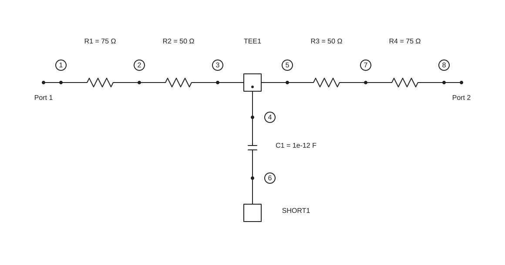
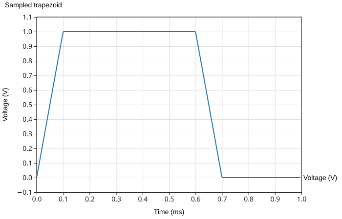
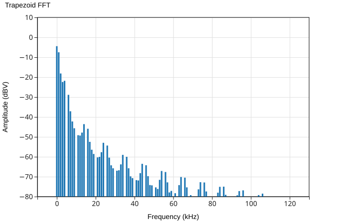
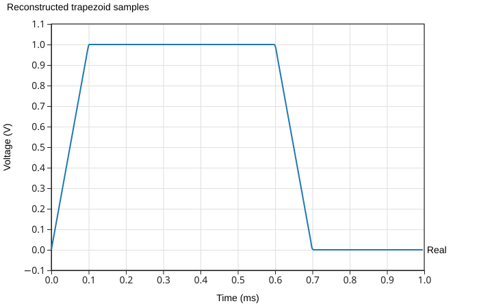
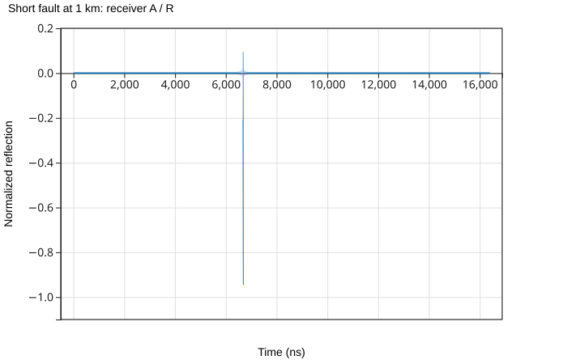
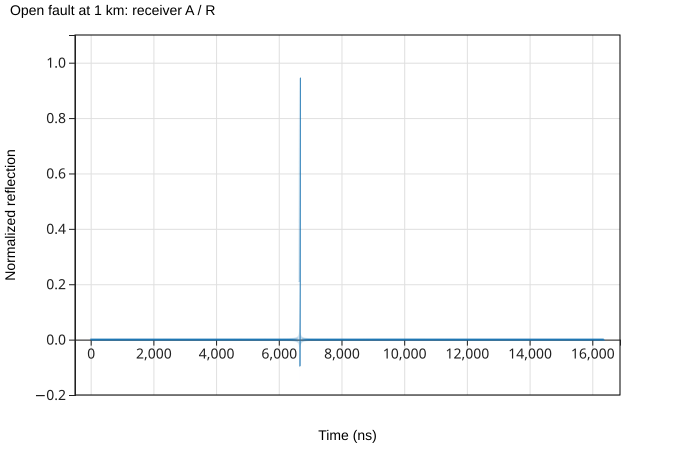

<!-- Modified: 2026-11-09 -->
# What's new in nP 0.49.0

nP 0.49.0 brings circuit drawings, time-domain signals, and measurement experiments into the RF analysis workflow. Build a network, see its schematic, send a signal through it, and examine the result in time or frequency.

This page compares **`0.49.0`** with the published **`0.0.48`** release. The Obsidian plugin has its own release process in a separate repository.

## Draw the network you analyze

Call **`nP.schematic(network)`** alongside your chart or table. nP reads the components and connections used to build the network, then draws an SVG using its bundled canonical symbols. You can draw a single component, a two-port cascade, an arbitrary nodal network, or a mod–circuit–demod signal path.

For a larger circuit, put familiar engineering arrangement names beside the connections. Here the intended drawing is a series section, a ladder, and another series section, all in **one nodal network**:

```js
// Shape guidance beside the electrical connections
var g = nP.global;
g.fList = [2e9];

var r1 = nP.R(75);
var r2 = nP.R(50);
var c1 = nP.C(1e-12);
var tee1 = nP.Tee();
var short1 = nP.Short();

var network = nP.nodal(
    {series: [
        [r1, 1, 2],
        [r2, 2, 3]
    ]},
    {ladder: [
        [tee1, 4, 3, 5],
        [c1, 4, 6],
        [short1, 6],
        [r2, 5, 7]
    ]},
    {series: [
        [r1, 7, 8]
    ]},
    ['out', 1, 8]
);

nP.schematic(network);
```



The numbered nodes come from the `nodal()` connection rows. Shape names guide the arrangement while the electrical connections remain authoritative. Reusing a component object, as this example does with `r1` and `r2`, still creates separate drawing occurrences.

Supported shapes are `series`, `ladder`, `bridgedT`, `branchline`, `edgeCoupledFilter`, `powerDivider`, and `powerCombiner`. Without guidance, nP tries supported whole-network shape detection and then a generic layout. A flat netlist does not always reveal where an engineer intends one section to end and the next to begin; grouping supplies that missing information.

Live drawings include **Copy as png** and **Fit drawing** buttons, adjustable node/port/terminal dots, and a returned API exposing geometry, topology, detection, and errors. The pictures on this page are static SVG snapshots; open the REPL for the live controls.

[Try grouped layouts and dot options](./repl.md#example-schematic-groups-and-dots) · [Try automatic shape detection](./repl.md#example-schematic-shape-detection) · [Read the Schematics guide](./schematics.md)

## A time grid alongside the frequency grid

**`nP.global.tList` holds sample times in seconds**, just as `fList` holds analysis frequencies in hertz. `tGen(start, stop, points)` creates uniformly spaced times including both endpoints. This makes the sample interval, sample rate, and observation window explicit.

For 256 samples covering one 1 ms period without repeating its endpoint, use `tGen(0, period * 255 / 256, 256)`. The sample interval is 3.90625 µs, the sample rate is 256 kHz, and the FFT bin spacing is 1 kHz. A time grid gives the FFT enough information to label its frequency axis in hertz.

The time grid connects several new operations:

| Operation | What the engineer supplies | What it provides |
| --- | --- | --- |
| `waveform()` | Shape, voltage levels, period, and a time grid | Sampled values and chart tables |
| `FFT()` | Sample values and the matching uniform `tList` | Complex frequency bins, a populated `fList`, and output tables |
| `invFFT()` | The complete complex spectrum | Reconstructed complex samples and time-domain tables |
| Sampled `mod()` modes | Bits, text, or a PN source, rates, and matching `tList` | A transmitter with an analysis frequency grid |
| `demod()` | The transmitter or signal-bearing RF network | Recovered waveforms, data, and measurement results |

Separate circuits can keep independent settings with `nP.global()`. Existing property access such as `nP.global.fList = ...` remains supported.

[Read Global settings](./global-settings.md) · [Understand sampling and quantization](./tech-notes-sampling-and-quantization.md)

## Waveform → FFT → inverse FFT

Create a square wave, triangle, full-wave rectified sine, or a custom piecewise-linear waveform. The following custom trapezoid is sampled, transformed to frequency bins, and reconstructed. Each stage produces its own table for `lineChart()`; the example needs no JavaScript mapping helper.

```js
// Trapezoid in time, frequency, and reconstructed time
var g = nP.global;
var period = 1e-3;
g.tList = g.tGen(0, period * 255 / 256, 256);
g.fList = [];

var trapezoid = nP.waveform({
    shape: 'custom',
    period: period,
    points: [
        [0, 0],
        [0.1e-3, 1],
        [0.6e-3, 1],
        [0.7e-3, 0],
        [period, 0]
    ]
});

var samples = trapezoid.out('samples');
var fft = nP.FFT(samples);
var reconstructed = nP.invFFT(fft);

var timeTable = trapezoid.out('waveform');
var frequencyTable = fft.out('dBV');
var reconstructedTable = reconstructed.out('real');

nP.lineChart({
    inputTable: [timeTable],
    title: 'Sampled trapezoid',
    metricPrefix: 'milli',
    xAxisTitle: 'Time (ms)',
    yAxisTitle: 'Voltage (V)',
    showPoints: false
});
nP.lineChart({
    inputTable: [frequencyTable],
    title: 'Trapezoid FFT',
    plotType: 'bar',
    barBaseline: -80,
    yRange: [-80, 10],
    metricPrefix: 'kilo',
    xAxisTitle: 'Frequency (kHz)',
    yAxisTitle: 'Amplitude (dBV)'
});
nP.lineChart({
    inputTable: [reconstructedTable],
    title: 'Reconstructed trapezoid samples',
    metricPrefix: 'milli',
    xAxisTitle: 'Time (ms)',
    yAxisTitle: 'Voltage (V)',
    showPoints: false
});
```







The reconstructed samples agree with the original samples to numerical precision. `fft.out('dBV')` supplies a one-sided RMS voltage spectrum for real voltage inputs, with a default display floor of −80 dBV. The complete complex `fft` array retains phase for reconstruction; the displayed dBV table is for plotting. FFT and inverse FFT also accept complex samples for other analyses.

[Run the trapezoid round trip](./repl.md#example-trapezoid-fft-round-trip) · [See square-wave harmonics](./repl.md#example-square-wave-fft) · [See rectified-sine harmonics](./repl.md#example-full-wave-rectified-sine-fft) · [Read FFT theory and nP usage](./tech-notes-fft-in-nport.md)

## Send digital and modulated signals through RF networks

The new digital APIs make an RF network part of a signal experiment. `mod()` creates a transmitter, a cascade or nodal network carries its signal, and `demod()` reconstructs the receiver output. `PN()` produces clocked pseudorandom patterns; `bitErrorRate()` compares transmitted and received bits.

Examples range from sending ASCII text through an attenuator to PSK, QAM, and OFDM reception. Sampled carrier modes also include OOK, ASK, FSK, DPSK, QPSK, MSK, and GMSK. Analog AM, FM, PM, SSB, and DSB-SC modes support tone-based analysis.

Set the time grid before the transmitter, then create the RF components after `mod()` establishes their analysis frequencies. Receiver noise is enabled by default for sampled digital modes; turn it off for an ideal repeatable comparison. See the Guide for mode-specific sample counts, rates, and receiver settings.

[Send ASCII through a circuit](./repl.md#example-ascii-through-circuit) · [Try QAM and OFDM](./repl.md#example-qam-ofdm) · [Compare bit error rates](./repl.md#example-ber-attenuation) · [Read Digital signals](./digital-signals.md)

## Build a VNA experiment in frequency or time

Use the same reference, reflection, and transmission receiver approach for two different views of a DUT:

- **`VNA-frequency`** uses the selected frequency list to measure complex reflection and transmission. The inductor example compares receiver-derived S11 and S21 with the direct S-parameters of `nP.L(5e-9)`.
- **`VNA-time`** uses a time grid to establish evenly spaced tones, applies the circuit response to those tones, and synthesizes an impulse response. The cable example shows opposite-polarity returns from open and short faults at 1 km.





For this ideal line, the return travels 2 km at the speed of light: **about 6.671 µs**. The example includes a measured-versus-calculated transit-time table. Finite measurement bandwidth gives the synthesized pulse sidelobes; the Tech Note explains why a short's negative return can have a small positive excursion nearby.

[Locate the cable fault](./repl.md#example-vna-short-reflection) · [Measure inductor S-parameters](./repl.md#example-vna-port1) · [View its impulse response](./repl.md#example-vna-inductor-time) · [Read the time-domain](./tech-notes-vna-time-domain-reflection.md) and [frequency-domain](./tech-notes-vna-frequency-domain-measurement.md) VNA notes

## Follow gain, noise, and distortion together

Noise and weak nonlinear source information now travel with connected n-ports. `Amp()` and `Attn()` make it straightforward to compare amplifier–attenuator ordering, including gain, noise figure, and output noise density. Two-tone analysis adds IM2, IM3, harmonics, and output intercept estimates through `.out(...)` selectors.

These models describe noise and weak-signal distortion under their documented conditions. They do not turn the network analysis into a general large-signal transient or compression simulator.

[Compare amplifier and attenuator ordering](./repl.md#example-noise-order) · [Plot two-tone IM3](./repl.md#example-two-tone-ip3) · [Read Noise](./noise.md) and [Intermodulation](./intermodulation.md)

## More RF components and clearer examples

New constructors include `Amp()`, `Attn()`, `Thru()`, the ideal broadband `Coupler180()`, and the center-tapped three-port autotransformer `trfAuto()`. The 1N4148 model now connects DC bias inspection with RF, noise, and weak-signal distortion behavior. Matrix inversion and solving return new matrices without altering caller-owned data.

The Guide and REPL now share circuit examples with links between the explanation and the runnable code. Four separate low-pass examples show `.cas()`, `cascade()`, `nodal()`, and `lpfGen()` directly. Circuit illustrations are SVG output from the actual nP schematic and chart calls. Charts support bar plots, linear y-axis padding, and readable REPL output on narrow screens through horizontal scrolling.

[Browse circuit examples](./circuit-examples.md) · [Explore RF constructors](./rf-constructors.md) · [Learn from engineering Tech Notes](./tech-notes.md)

## Before updating

The version is **`0.49.0`**, following **`0.0.48`**. Ordinary `global.fList` access, flat nodal connection rows, cascades, and the existing combined RLC constructors remain available. The new time and signal APIs require attention to sample-grid and frequency-grid ordering. Shape groups help larger compositions; automatic detection cannot yet infer every intended section boundary.

See the [release notes and compatibility checklist](https://github.com/JerryWiltz/nP/blob/master/CHANGELOG.md#0490--2026-11-09) before migrating. An installed Obsidian plugin keeps its own pinned nP bundle until that separately maintained plugin is updated and released.
